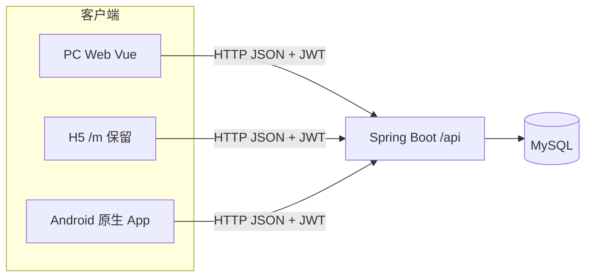

# Android 原生客户端设计（P2 购买闭环）

> 项目：星选商城 STARX / eshop-release-v1.01  
> 文档位置：`docs/02-设计文档/Android原生客户端设计-P2.md`  
> 状态：S1+S3 已落地（商品浏览闭环）；购物车/地址/订单待 S4–S5；本机 `assembleDebug` 已通过  
> 关联：`接口设计.md`、`后端接口冻结说明-v1.0.md`、根目录 `星选商城-v1.01-对话记忆.md`、`DESIGN.md` / `PRODUCT.md`

## 修订记录

| 版本 | 日期 | 修改人 | 修改说明 |
|------|------|--------|----------|
| v1.0 | 2026-08-11 | 续作会话 | 初稿：真·Android 原生 + P2 范围、架构、接口映射、分阶段实施与文档纪律 |
| v1.1 | 2026-08-11 | 续作会话 | S1 脚手架落地：`android/` 工程、主题/网络/Token/导航；登录注册 UI 已接 API 契约 |
| v1.2 | 2026-08-11 | 续作会话 | S3 商品：分类/搜索/列表/热销/详情/SKU 加购；`assembleDebug` 通过 |
| v1.3 | 2026-08-11 | 续作会话 | S3 图片与列表性能：内置 WebP 缩略图、详情回退策略、Coil 解码与缓存约束 |
| v1.4 | 2026-08-11 | 续作会话 | S3 真机性能复测：缩略图预热、双列行级懒布局、V2307A 高刷滑动帧数据与 R8 性能包验证 |

---

## 1. 背景与目标

### 1.1 背景

当前仓库已具备完整的 **前后端分离** 商城能力：

- 后端：Spring Boot 3 + JWT + MyBatis-Plus + Flyway，统一前缀 `/api`
- 前端 Web：Vue 3；PC（Element Plus）与手机 H5（Vant，路径 `/m`）
- 部署：Docker Compose（MySQL + backend + frontend/Nginx）

手机 H5 属于 **浏览器内响应式/适配页面**，不是安装形态的原生客户端。产品方向调整为：

- **不再以响应式网页作为主交付手机端**
- **先做 Android 真原生客户端**，复用现有 REST 接口
- 现有 `/m` H5 **保留作对照与备用**，不强制删除

### 1.2 目标

交付可安装的 **Android APK**，完成 **P2 购买闭环** 演示：

**登录/注册 → 商品浏览（分类/搜索/列表/详情）→ 加购 → 购物车 → 地址 → 下单 → 模拟支付 → 订单列表/详情**

### 1.3 非目标（本阶段明确不做）

| 不做项 | 说明 |
|--------|------|
| 收藏 / 浏览历史 / 评价晒图 | 归入后续 P3 |
| 个人资料完整编辑 | P3；本阶段「我的」仅地址管理 + 退出 |
| 商家端 / 平台管理端 App | 仍使用 Web 后台 |
| 真实支付渠道 | 继续调用现有模拟支付接口 |
| 推送、地图选点、分享 | 不在 P2 |
| 重写或破坏性修改后端业务 API | 接口以冻结文档为准 |
| 用 Capacitor/WebView 壳包装 H5 冒充原生 | 与选型 A 冲突 |

---

## 2. 决策摘要

| 决策项 | 结论 |
|--------|------|
| 客户端形态 | 真·Android 原生应用（APK） |
| UI 技术 | Kotlin + Jetpack Compose + Material 3 |
| MVP 范围 | **P2 购买闭环** |
| 后端 | 复用现有 `/api` + `Authorization: Bearer <JWT>` |
| 与 H5 关系 | `/m` 保留；主交付改为原生 App |
| PC / 管理端 | 不动 |
| 文档纪律 | **做到哪里写到哪里**（见第 10 节） |

### 2.1 方案对比（已选型）

| 方案 | 说明 | 结论 |
|------|------|------|
| **A. Kotlin + Compose** | 真原生控件与生命周期，答辩可强调原生客户端 | **已选** |
| B. Flutter | 跨端快，但非 Android 平台原生栈 | 未选 |
| C. Capacitor 壳包 H5 | 最快有安装包，本质仍是 WebView | 与「不用响应式当手机端」冲突，未选 |

### 2.2 工程结构方案（已选型）

| 方案 | 说明 | 结论 |
|------|------|------|
| **单 app module + 按功能分包** | 脚手架轻、适合 P2 与课程节奏 | **已选** |
| 多 module Clean Architecture | 规范但前期过重 | 未选（P3 或体量增大后再评估） |

---

## 3. 总体架构

### 3.1 系统上下文



- Android **不直连数据库**，只消费 HTTP API。
- 鉴权与 Web 一致：登录成功后持有 JWT，后续请求带 `Authorization: Bearer <token>`。
- 统一响应体：`{ "code": 0, "message": "success", "data": ... }`；`code !== 0` 视为业务失败。

### 3.2 客户端分层

```
UI (Compose Screens / Components)
        ↓  StateFlow / 用户事件
ViewModel (用例编排、加载/错误状态)
        ↓
Repository (错误映射、线程边界)
        ↓
API (Retrofit 接口定义)
        ↓
OkHttp (Token 拦截器、日志、超时)
```

原则：

1. **Screen 不直接持有 Retrofit**，只观察 ViewModel 状态。
2. **Repository 统一解析** `ApiResponse`，向上抛出可读错误信息。
3. **Token 仅存本地加密存储**，由拦截器自动注入 Header。
4. **401**（非登录接口）：清空 Token，导航至登录页。

---

## 4. 仓库与工程目录

### 4.1 在 monorepo 中的位置

```
eshop-release-v1.01/
├── 星选商城-v1.01-对话记忆.md
├── DESIGN.md
├── PRODUCT.md
└── eshop-release-v1.0/                 ← 工程根
    ├── backend/
    ├── frontend/                       ← PC + 现有 H5
    ├── android/                        ← 新建 Android 工程根
    ├── docs/
    │   └── 02-设计文档/
    │       └── Android原生客户端设计-P2.md   ← 本文档
    ├── docker-compose.yml
    └── scripts/
```

### 4.2 Android 工程包结构（目标）

```
android/
├── settings.gradle.kts
├── build.gradle.kts
├── gradle.properties
└── app/
    ├── build.gradle.kts
    └── src/main/
        ├── AndroidManifest.xml
        ├── java/com/eshop/starx/
        │   ├── StarxApp.kt
        │   ├── MainActivity.kt
        │   ├── core/
        │   │   ├── network/          # Retrofit、OkHttp、ApiResponse、拦截器
        │   │   ├── auth/             # TokenStore（EncryptedSharedPreferences）
        │   │   ├── ui/theme/         # 颜色、字体、Shape、Theme
        │   │   └── navigation/       # NavHost、路由常量
        │   ├── data/
        │   │   ├── api/              # 各业务 Retrofit 接口
        │   │   ├── model/            # 请求/响应 DTO
        │   │   └── repository/
        │   └── feature/
        │       ├── auth/
        │       ├── catalog/
        │       ├── cart/
        │       ├── address/
        │       └── order/
        └── res/
```

应用 ID 建议：`com.eshop.starx`  
应用显示名：星选商城 / STARX

---

## 5. 技术栈与版本基线

| 类别 | 选型 | 说明 |
|------|------|------|
| 语言 | Kotlin | 与现代 Android 主流一致 |
| UI | Jetpack Compose + Material 3 | 声明式 UI |
| 导航 | Navigation Compose | 单 Activity + NavHost |
| 网络 | Retrofit 2 + OkHttp | REST |
| JSON | Kotlinx Serialization 或 Moshi | 实施时二选一写死，全文统一 |
| 异步 | Coroutines + ViewModel + StateFlow | 标准 MVVM |
| 图片 | Coil | 商品图加载 |
| Token 存储 | EncryptedSharedPreferences | 避免明文 SharedPreferences |
| 最低系统 | minSdk **26**（Android 8.0） | 覆盖主流真机 |
| 编译 | compileSdk **35**，JDK **17** | 与后端 JDK 17 对齐便于本机环境 |

依赖具体版本在 **S1 建工程** 时写入 `android/README.md` 与 `app/build.gradle.kts`，并回填本节修订记录。

---

## 6. 功能范围与页面

### 6.1 P2 功能清单

| 模块 | 功能点 | 优先级 |
|------|--------|--------|
| 账号 | 注册、登录、退出、启动 Token 校验（可选拉 `/auth/me`） | 必做 |
| 商品 | 分类列表、关键词搜索、分页列表、详情、SKU 选择、加入购物车 | 必做 |
| 购物车 | 列表、改数量、删除、去结算 | 必做 |
| 地址 | 列表、新增、设默认、删除（编辑可选） | 必做 |
| 订单 | 确认订单、创建订单、模拟支付、订单列表、订单详情 | 必做 |
| 订单动作 | 取消订单、确认收货（接口已存在则接入） | 必做 |
| 热销 | 首页或列表旁展示热销（有接口则接，失败可降级隐藏） | 建议做 |

### 6.2 信息架构与导航

```
冷启动
  ├─ 无有效 Token → 登录页（可切注册）
  └─ 有 Token → 主框架（底部 Tab）
        ├─ Tab1 首页/商品：分类 Chip + 搜索 + 列表（可含热销入口）
        ├─ Tab2 购物车
        ├─ Tab3 订单
        └─ Tab4 我的：地址管理入口 + 退出登录

栈内二级路由：
  商品详情
  确认订单（Checkout）
  模拟支付
  订单详情
  地址新增 / 编辑
```

### 6.3 页面状态约定

每个主要列表/详情页至少具备：

- **Loading**：首次加载指示
- **Content**：正常数据
- **Empty**：空购物车、空订单等
- **Error**：可重试（网络失败、业务 message 展示）

库存不足、状态冲突等后端 409 类错误：以 Snackbar / 对话框展示 `message`，不静默失败。

---

## 7. 接口映射

> 权威来源：`docs/02-设计文档/接口设计.md` 与前端 `frontend/src/api/*.js`。  
> 下列路径均相对于 Base URL 的 `/api` 前缀（Retrofit `baseUrl` 以 `/api/` 结尾）。

### 7.1 鉴权与用户

| 能力 | 方法 | 路径 | 鉴权 |
|------|------|------|------|
| 注册 | POST | `/auth/register` | 匿名 |
| 登录 | POST | `/auth/login` | 匿名 |
| 退出 | POST | `/auth/logout` | 登录 |
| 当前用户 | GET | `/auth/me` | 登录 |

说明：

- 买家注册 `role` 默认 `USER`（可不传或显式 `USER`）。
- 登录成功后持久化 JWT；后续请求统一 Header：`Authorization: Bearer <token>`。

### 7.2 分类与商品

| 能力 | 方法 | 路径 | 鉴权 |
|------|------|------|------|
| 分类列表 | GET | `/categories` | 可匿名 |
| 商品分页 | GET | `/products` | 可匿名 |
| 商品详情 | GET | `/products/{id}` | 可匿名 |
| 热销排行 | GET | `/products/hot-ranking` | 可匿名 |

查询参数对齐 Web：如 `keyword`、`categoryId`、`current`、`size`；热销 `days`、`limit`。

### 7.3 购物车

| 能力 | 方法 | 路径 | 鉴权 |
|------|------|------|------|
| 购物车列表 | GET | `/cart` | 登录 |
| 加购 | POST | `/cart` | 登录 |
| 改数量 | PATCH | `/cart/{itemId}` | 登录 |
| 删除项 | DELETE | `/cart/{itemId}` | 登录 |

### 7.4 地址

| 能力 | 方法 | 路径 | 鉴权 |
|------|------|------|------|
| 地址列表 | GET | `/addresses` | 登录 |
| 新增 | POST | `/addresses` | 登录 |
| 更新 | PUT | `/addresses/{id}` | 登录 |
| 设默认 | PATCH | `/addresses/{id}/default` | 登录 |
| 删除 | DELETE | `/addresses/{id}` | 登录 |

### 7.5 订单与支付

| 能力 | 方法 | 路径 | 鉴权 |
|------|------|------|------|
| 创建订单 | POST | `/orders` | 登录 |
| 订单分页 | GET | `/orders` | 登录 |
| 订单详情 | GET | `/orders/{id}` | 登录 |
| 状态日志 | GET | `/orders/{id}/logs` | 登录（可选展示） |
| 模拟支付 | POST | `/orders/{id}/pay` | 登录 |
| 取消订单 | POST | `/orders/{id}/cancel` | 登录 |
| 确认收货 | POST | `/orders/{id}/confirm` | 登录 |

### 7.6 网络与环境

| 环境 | Base URL 建议 | 备注 |
|------|----------------|------|
| 模拟器 → 本机后端 | `http://10.0.2.2:8080/api/` | `10.0.2.2` 映射宿主机 localhost |
| USB 真机 → 共享后端 | `http://127.0.0.1:8080/api/` | 配合 `adb reverse tcp:8080 tcp:8080` |
| Docker 正式部署 | 由 Nginx/网关提供 `/api` | 不作为 Android 本地联调的第二套后端 |

配置方式：

- `BuildConfig.API_BASE_URL` 或 `local.properties` / productFlavor 区分 debug。
- **仅 debug** 允许 HTTP cleartext（`usesCleartextTraffic` 或 network security config）；release 应优先 HTTPS（若无证书环境可文档注明课程演示例外）。

#### 7.6.1 本地共享后端约定（2026-08-12）

- 电脑网页、Android 模拟器与 USB 真机必须共用项目根目录 `scripts/start-shared-backend.ps1` 启动的唯一 `8080` 后端，不再为 Android 启动单独的 H2 内存预览库。
- 数据保存到 `data/shared-backend/eshop.mv.db`；服务重启不会重新执行种子脚本，因此电脑后台新增/修改的商品、库存、用户、购物车和订单会被 Android 读取，反之亦然。
- PC Vite 保持 `/api -> http://127.0.0.1:8080`；Android 模拟器使用 `http://10.0.2.2:8080/api/`；USB 真机使用 `http://127.0.0.1:8080/api/` 并通过 `adb reverse tcp:8080 tcp:8080`。三者只是在网络入口不同，目标服务与数据库相同。
- Android 商品图片以后端响应 `mainImage` 为主数据源，列表和详情共用；本地 WebP 仅在网络图片失败或滚动缓存未命中时兜底，避免手机端再维护一份独立商品图片数据。

图片 URL：若接口返回相对路径（如 `/uploads/...`），客户端拼接为 `origin + path`（去掉末尾 `/api` 的 host 部分需在工具类中约定清晰）。

### 7.7 图像资源与列表性能

- 商品列表优先使用接口返回的 `mainImage`，详情使用同一字段；`res/drawable-nodpi/catalog_*.webp` 中的 6 张本地 512px WebP 仅作为失败兜底。这样电脑端保存商品主图后，Android 不再维护第二份商品图片数据。
- 列表主图请求固定为 200px、`RGB_565`、无淡入；滑动中只读取内存缓存，停止后恢复网络/磁盘缓存，降低图片渲染对滑动帧的影响。
- 首页组合后在后台预热全部 6 张本地缩略图；应用不限制系统高刷新率，日常显示交由设备按高刷策略调度。
- 双列商品视觉由每行两张卡片的 `LazyColumn` 实现，减少滚动时的懒布局测量数量；卡片圆角裁剪仅覆盖图片顶部区域，避免整张卡片参与裁剪合成。
- 后端图片失败时，列表和详情统一使用 `catalogImageResource(name, categoryId, productId)` 作为回退，确保同一商品即使离线也不会出现列表/详情图片不一致。当前只有 6 张本地 WebP，同类商品允许复用图片。
- 已完成 `assembleDebug` 与 `assemblePerformance` 构建验证。vivo V2307A 在系统 `120Hz` 下的 debug 压力滑动采样为：`p50=11ms`、`p90=21ms`、`p95=26ms`、掉帧比例 `12.07%`、慢位图上传 `0`；因此不能以此前 60fps 预算数据替代。独立的 R8 优化 `performance` APK（`com.eshop.starx.performance`，关闭 debug 标记和 HTTP 日志）已在相同设备、相同 8 轮上下滑动口径下连续复测两次：首轮 `p50=5ms`、`p90=8ms`、`p95=8ms`、`p99=14ms`、掉帧 `0.62%`、慢位图上传 `0`；复测 `p50=5ms`、`p90=6ms`、`p95=7ms`、`p99=8ms`、掉帧 `0%`，慢 UI 线程、慢位图上传和慢绘制提交均为 `0`。两轮均达到本机 `120Hz` 的 `8.33ms` 帧间隔目标；测试范围为已预热的商品首页列表，其他页面新增复杂交互后应独立复测。
- 首页视觉与分类状态修复完成后的同口径 performance 回归为：`883` 帧，`p50=5ms`、`p90=7ms`、`p95=7ms`、`p99=9ms`，新版 Janky frames `0%`，慢 UI 线程、慢位图上传、慢绘制提交均为 `0`；确认本轮 UI 调整未引入首页滚动性能回退。

### 7.8 统一错误处理

| 场景 | 客户端行为 |
|------|------------|
| HTTP 200 且 `code == 0` | 使用 `data` |
| HTTP 200 且 `code != 0` | 展示 `message`，不更新成功态 |
| HTTP 401（非登录接口） | 清 Token，跳转登录 |
| HTTP 403 | 提示无权限/账号禁用 |
| HTTP 404 / 409 | 展示业务 message（库存、状态冲突等） |
| 网络超时 / 无连接 | 通用「网络异常」+ 重试 |

与订单超时挑战模块（C03）相关：未支付订单可能被后端自动取消；支付/详情接口失败时必须展示后端返回文案。

---

## 8. UI / 视觉原则

对齐产品品牌 **星选商城 STARX**，但交互遵循 **Material 3 手机范式**，不照搬 PC 三栏布局。

| 项 | 建议值 |
|----|--------|
| 主色（操作/价格强调） | `#E5484D` 或现网主色 `#FF4D4F`（实施时定一，写入 theme） |
| 页面背景 | 近暖白 / 中性浅灰（参考 `DESIGN.md` 的 page/surface） |
| 正文色 | 石墨深色，保证对比度 |
| 圆角 | 控件 8dp 级，卡片 12dp 级 |
| 触控 | 主按钮高度约 48dp；列表行可点区域充足 |

不引入第二套「彩虹操作色」；光谱色仅用于品牌标题类装饰（若使用，不得当作按钮状态色）。

### 8.1 首页视觉与筛选状态（2026-08-11）

- 首页采用 `Material 3` 的原生操作型界面，设计参数为视觉变化 `5`、动效 `2`、信息密度 `6`。页面使用冷中性背景和白色商品表面，品牌红只用于价格、分类选中和主要操作。
- 品牌标题使用单个 `AnnotatedString` 逐字着色，保留用户要求的彩虹观感，同时不在滚动或页面切换路径创建渐变着色器。
- 搜索使用原生单行输入框和 IME Search；分类使用紧凑 Tab 与固定宽度选中指示器，不使用大面积胶囊 Chip。
- 首页覆盖 Loading 骨架、Content、Empty、Error 和分页加载状态；骨架尺寸与双列商品卡一致，避免数据到达时发生明显布局跳变。
- 分类/搜索请求由 `HomeViewModel` 持有可取消 `Job`，旧响应必须通过当前分类和关键词校验后才能写入状态，避免“手机数码”与“全部”快速切换时出现旧数据覆盖。筛选变化会把 `LazyListState` 重置到顶部。
- 真机验证路径：全部 `18` 件 → 手机数码 `6` 件且热销隐藏 → 全部 `18` 件且热销恢复；首个“智能手机 A1”在列表与详情均显示 `catalog_phone.webp`。
- 开发者选项的系统刷新率叠加层会在屏幕左上角显示 `120`，可能与标题区域重叠；验收 App UI 时需与系统覆盖层区分。

---

## 9. 分阶段实施计划

| 阶段 | 名称 | 交付物 | 完成定义（DoD） |
|------|------|--------|-----------------|
| **S0** | 设计定稿 | 本文档 v1.0 + 记忆日志 | 用户确认文档可实施 |
| **S1** | 工程脚手架 | `android/` 可编译空壳、主题、网络层、TokenStore、导航骨架 | 模拟器启动到占位首页；README 写清如何改 Base URL |
| **S2** | 账号 | 登录、注册、退出、Token 持久化 | 真实后端可登录并进入主页 |
| **S3** | 商品 | 列表/分类/搜索/详情/SKU 加购 | 未登录可浏览；登录可加购 |
| **S4** | 购物车 + 地址 | 购物车 CRUD、地址管理 | 可改数量删除；可选地址 |
| **S5** | 订单闭环 | Checkout、下单、模拟支付、列表/详情、取消/确认收货 | 完整走通一笔模拟订单 |
| **S6** | 联调与交付 | Docker/本机联调、演示路径、APK 构建说明 | 演示脚本可按文档复现 |

**实施顺序约束**：必须 S1 → S2 → S3 → S4 → S5 → S6；不可跳过网络与鉴权直接堆页面假数据作为最终交付（开发期可用 Fake 但合并前接真 API）。

---

## 10. 文档纪律（强制）

用户约定：**做到哪里写到哪里**。

### 10.1 必须更新的位置

| 位置 | 何时写 |
|------|--------|
| 本文件 `Android原生客户端设计-P2.md` | 架构/范围变更时改正文；每完成阶段在 **「11. 实施进度」** 打勾并写日期 |
| `星选商城-v1.01-对话记忆.md` 第十二节 | 每个任务/阶段结束后追加日志 |
| 同记忆文档第十三节 | 新增用户约定时追加 |
| `android/README.md`（S1 创建） | 环境、运行、Base URL、打包 |

### 10.2 日志最低字段

每次进度写入建议包含：

1. 日期与阶段编号（如 `2026-08-11 — S1 脚手架`）
2. 完成了什么
3. 改动的关键路径
4. 如何验证（命令或操作步骤）
5. 已知问题 / 下一步

### 10.3 接口变更规则

- 若必须改后端：先改 `接口设计.md` / 冻结说明流程，再改代码，并在本文件第 7 节同步。
- Android 仅作适配字段时：在本文件或 `android/README.md` 注明与 Web 的差异。

---

## 11. 实施进度

> 实施过程中只更新本节与修订记录，保持「当前做到哪」可一眼看出。

| 阶段 | 状态 | 完成日期 | 备注 |
|------|------|----------|------|
| S0 设计定稿 | ✅ 完成 | 2026-08-11 | 设计文档 v1.0 |
| S1 工程脚手架 | ✅ 完成 | 2026-08-11 | `assembleDebug` 成功；SDK 路径已配置 |
| S2 账号 | 🔄 基本完成 | 2026-08-11 | 登录/注册/退出已接 API；启动 `/auth/me` 校验可后续补 |
| S3 商品 | ✅ 完成 | 2026-08-11 | 分类/搜索/双列列表/热销/详情/SKU/加购；已内置 WebP 缩略图并限制列表图片解码开销 |
| S4 购物车+地址 | ⬜ 未开始 | | |
| S5 订单闭环 | ⬜ 未开始 | | |
| S6 联调与交付 | ⬜ 未开始 | | |

---

## 12. 风险与对策

| 风险 | 影响 | 对策 |
|------|------|------|
| 模拟器/真机访问不到后端 | 无法联调 | 文档写清 `10.0.2.2` 与局域网 IP；debug 允许 cleartext |
| 后端未启动或端口不一致 | 全链路失败 | README 列出 8080 / 8088 两种部署 |
| 订单超时自动取消（C03） | 支付瞬间失败 | UI 展示后端 message；演示时控制在超时窗口内 |
| 图片相对路径 | 裂图 | 统一 Url 拼接工具 |
| 范围膨胀到 P3 | 延期 | 严格按第 6 节非目标砍需求 |
| 接口字段与文档微差 | 解析失败 | 以实际响应为准，差异记入文档 |

---

## 13. 验收标准（P2）

在后端可用的前提下，演示者应能：

1. 安装并打开 Android App（debug 包即可）。
2. 注册或登录买家账号。
3. 按分类或关键词找到商品，进入详情选择 SKU 加入购物车。
4. 在购物车修改数量，进入结算并选择/新增收货地址。
5. 提交订单并完成 **模拟支付**。
6. 在订单列表看到该订单，进入详情查看状态；对未支付单可取消，对已发货单可确认收货（若演示数据支持）。
7. 退出登录后受保护接口不可继续访问（回到登录页）。

---

## 14. 开放问题（实施前可再定，不阻塞 S0）

| 编号 | 问题 | 默认假设 |
|------|------|----------|
| Q1 | JSON 库选 Serialization 还是 Moshi | **已定：Kotlinx Serialization** |
| Q2 | 是否使用 Hilt 依赖注入 | **已定：P2 不用 Hilt**，`NetworkModule` + 构造注入 Repository |
| Q3 | 是否做离线缓存 | P2 不做，仅内存/页面级状态 |
| Q4 | 应用图标与启动页精细度 | S1 已用矢量自适应图标占位；S6 前可再美化 |

---

## 15. 下一步

1. **用户审阅本文档**，确认无修改或提出修订。  
2. 确认后进入 **S1**：创建 `android/` 工程脚手架，并同步更新本节进度与对话记忆。  
3. 详细任务拆解可另出《Android 实施计划》（writing-plans），按 S1–S6 执行。

---

*本文档为 Android 原生客户端 P2 的正式设计基线；实施以本文 + 冻结接口文档为准。*

### 2026-08-12 - 商品详情结构化内容显示

- `ProductDetailScreen` 不再直接显示后端 `detail` 原始字符串。Android 新增 `ProductDetailContent.kt`，解析 `detail.version=1` JSON，并按卖点、介绍段落、参数逐块展示；旧数据的纯文本详情保留兼容兜底。
- 该修复只改变详情内容呈现，不改变图片、SKU、购物车或滚动性能策略。性能包构建已通过；真机覆盖安装因 vivo USB 安装确认被拒绝，需设备允许后再做最终截图验收。

### 2026-08-12 - 图片链路与跨端视觉统一

- 商品图片链路以后端 `mainImage` 为唯一主来源；Android Coil 图片加载器接入与 Retrofit 相同的 JWT 拦截器，并保留本地 WebP 兜底。共享预览后端明确放行 `GET /demo/**` 静态演示资源，解决真机请求 `401` 导致多商品复用兜底图的问题。
- PC 与 Android 统一暖白零售视觉：页面 `#F7F4F1`、白色 surface、品牌红 `#FF4D4F`、暖灰边框、10dp 卡片圆角。彩虹标题保留为品牌识别元素，但商品卡、热销区、搜索框和底部导航使用克制的同一套语义色。
- 性能边界不变：图片尺寸固定、列表使用 RGB_565 和内存缓存，预加载仍在进入首页时执行，滚动期间不发起网络请求或 SVG 解码；未增加模糊、重阴影或复杂滚动动画。
- 真机验收：vivo V2307A 安装 `com.eshop.starx.performance`，列表中 A1 / Pro 等商品显示不同后端图片，详情主图与列表一致；USB reverse 图片请求 `200`，性能包构建成功。

### 2026-08-12 - 商品主图质量与稳定展示

- 主图规范：共享后端与 PC 静态目录中的 18 张商品主图统一为 `1200x900` 的目录画幅，使用 `#F7F4F1` 中性背景、主体居中、等比缩放。保留竖版手机的完整外观，不通过粗暴裁切截断产品；清理不适合作为商品主图的排行榜海报、促销价签和多机拼图。
- Android 展示：`StarxProductImage` 的列表模式改为稳定 `ContentScale.Crop` 和中性媒体底色，产品卡图区域尺寸保持不变；解码从 `200px RGB_565` 提升到 `512px ARGB_8888`，解决明显的色阶断层、发糊与浅粉露边。
- 缓存策略：仅对 `/api/demo/products/*` 加图片版本参数 `rev=20260812`，不影响普通接口或页面缓存；替换静态图后手机和 PC 都能请求新资源，不需要清空应用全部数据。
- 验收：共享后端健康检查和版本化图片接口均为 `200`；`assemblePerformance` 构建通过，并已 USB 覆盖安装到 vivo V2307A。真机首屏确认列表读取更新后的独立主图。

### 2026-08-13 - 最终零售封面规范

- 本规范替代此前 `1200x900` 试验方案。PC 与 Android 共用 18 张方形主图和 1:1 图片位，用户未进入详情前即可看到完整商品形态。
- 场景实拍图允许满版构图；白底或纯色单品图必须保留完整轮廓并放大到接近边缘，留少量安全区。禁止模糊延展、图中图边框、促销价签、排行榜海报和多商品拼图。
- 自然满版实拍封面保留原始清晰边缘，不再统一羽化；独立单品图保留完整轮廓，避免轮廓发虚。只有源图存在突兀接缝且不影响主体时才允许离线融合。
- 素材优化在生成阶段离线完成，App 运行时不使用模糊、遮罩或滤镜。Android 固定方形图片位、512px `ARGB_8888` 解码和内存缓存；PC 取消悬停图片放大，避免再次裁掉商品边缘。
- 缓存版本更新为 `20260813-coverfix`。前端生产构建、Android performance 构建和界面检测通过；PC 商品列表与 vivo V2307A 真机截图均确认两端封面一致。
- 最终真机滚动回归：共 757 帧，Janky 5 帧（`0.66%`），`p50=5ms`、`p90=7ms`、`p95=8ms`、`p99=13ms`，慢位图上传为 0。

### 2026-08-13 - 商品封面边缘与填充修正

- 封面融合由统一规则改为按素材判断：自然满版场景保留原始清晰边缘；只有源图存在突兀接缝且不影响商品主体时，才允许离线融合。
- 台灯、空气净化器及其余原先羽化的满版场景封面恢复未羽化零售版本。
- 电水壶封面从现有真实商品抠图重构：去除 50px 不透明白框和透明内框，放大完整商品，并使用无缝暖灰棚拍背景与克制的接触阴影填满方形画布，不使用模糊延展。
- 处理仍完全发生在离线素材阶段。Android 不增加模糊、遮罩、滤镜、动态阴影或滑动时图片计算；1:1 图片位、512px `ARGB_8888`、内存缓存和 `ContentScale.Crop` 保持不变。缓存版本为 `20260813-coverfix`。
- 验证结果：前端生产构建与 `:app:assemblePerformance --no-daemon` 均通过；运行中的共享后端返回新版台灯和电水壶资源，PC 家居生活分类截图确认实际 1:1 卡位裁切正确。ADB 服务重启后仍未列出已授权 USB 设备，因此本轮未进行真机覆盖安装和新一轮帧率采样。
