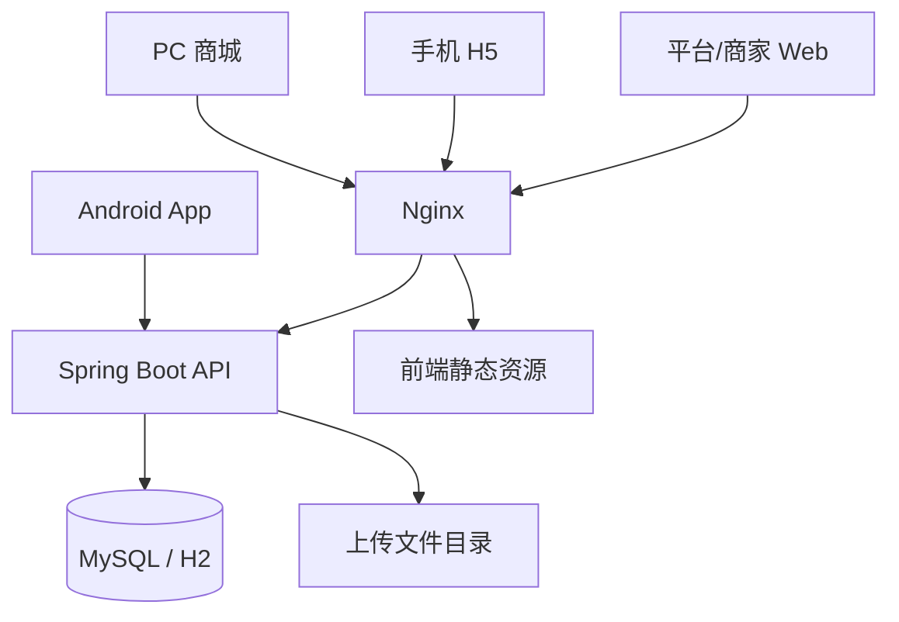

# STARX 星选商城 · 系统架构设计

> 版本：v1.1

## 修订记录

| 版本 | 说明 |
|------|------|
| v1.0 | 初版分层与选型 |
| v1.1 | 补充多端与共享后端开发模式 |

## 一、技术选型

| 分层 | 选型 | 说明 |
|------|------|------|
| 前端 | Vue 3 + Vite + Pinia | PC/管理端 Element Plus；H5 Vant |
| 后端 | Spring Boot 3 + Security + JWT | 无状态鉴权，利于多端 |
| ORM | MyBatis-Plus | 业务 CRUD 高效 |
| 迁移 | Flyway | 结构演进可追踪 |
| 数据库 | MySQL 8.4 | 生产/Compose；本地可 H2 预览 |
| 网关 | Nginx | 统一静态与 `/api` 反代 |
| 原生 | Kotlin + Compose | Android 客户端可选交付 |

## 二、总体架构

## 三、模块划分

### 3.1 前端

- 路由按端拆分：`/pc`、`/m`、`/admin`、`/seller`
- 状态：Pinia（鉴权与会话）
- 公共能力：HTTP 封装、购物车角标、商品视觉与详情 JSON 解析

### 3.2 后端

- 控制层 / 服务层 / 持久层
- 业务包：auth、user、catalog、cart、address、order、review、favorite、analytics、admin
- 横切：JWT 过滤器、全局异常、操作日志切面、订单超时调度

## 四、关键决策

| 决策点 | 方案 | 理由 |
|--------|------|------|
| 鉴权 | JWT Bearer | 多端无会话粘性 |
| 支付 | 模拟支付 | 演示闭环，不接真实收单 |
| 图片 | 静态资源 + 上传目录 | 简单可部署 |
| 角色 | BUYER / SELLER / ADMIN | 权限边界清晰 |
| 本地联调 | 共享 H2 后端脚本 | PC 与 Android 共数据 |

## 五、环境

| 环境 | 用途 |
|------|------|
| 本地共享后端 | 开发联调（`scripts/start-shared-backend.ps1`） |
| Docker Compose | 一体化演示 / 准生产 |
| 冒烟脚本 | 回归主路径 |

## 六、工程约定

- API 统一响应结构；错误码可追踪
- 数据库变更必须 Flyway 迁移
- 密钥与管理员口令仅通过环境变量注入
